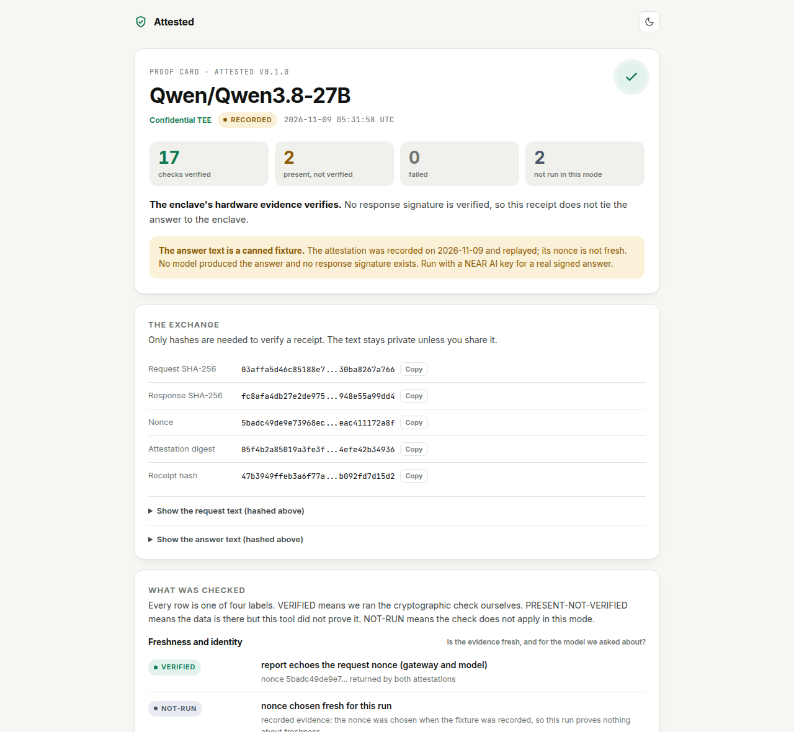
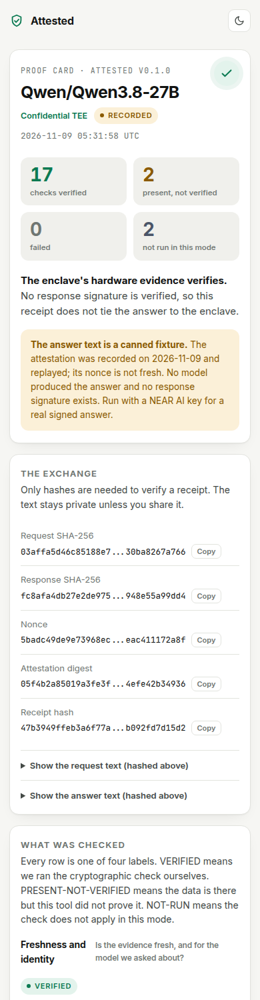
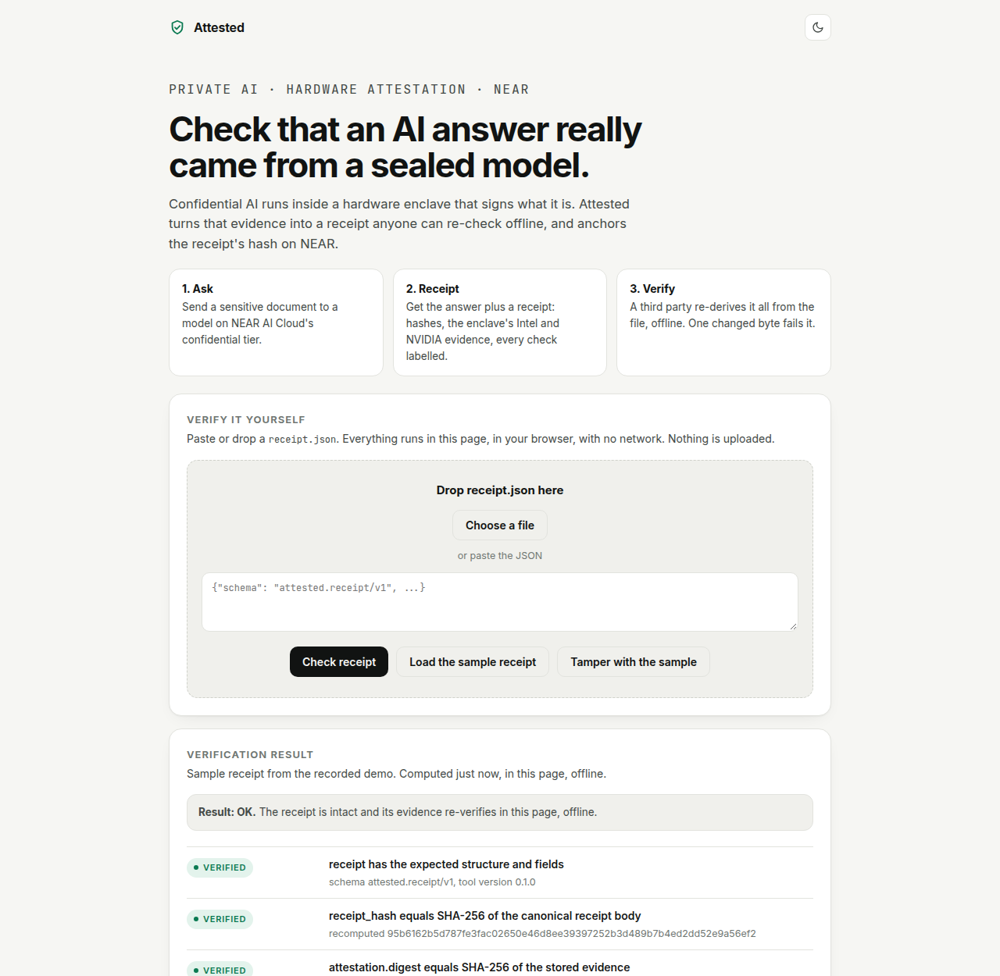

# Attested

**Anyone can check that an AI answer really came from a hardware-sealed (TEE) model, and the proof lives on NEAR.**

Attested turns the hardware evidence of a private AI model on [NEAR AI Cloud](https://docs.near.ai) into a portable **receipt** and a self-contained **Proof Card** (HTML). A third party can re-check the receipt completely offline: one changed byte makes it fail. The receipt's hash can be anchored in a small Rust contract on NEAR.

Tracks: **Privacy & Private AI** (primary), **AI Security & Defense**.



<p>


</p>

## What it is

- `attested attest`: fetches a **live** attestation report from NEAR AI Cloud (no API key, fresh random nonce) and runs every check it can run honestly. Each check is labelled `VERIFIED`, `PRESENT-NOT-VERIFIED`, `FAILED` (or `NOT-RUN` when it does not apply in the current mode).
- `attested ask`: with `NEAR_AI_API_KEY`, one real non-streaming chat on a **Confidential TEE** model plus a response-signature check. Without a key it runs in clearly labelled **RECORDED** mode.
- `receipt.json` + `receipt.html`: the portable receipt and its Proof Card.
- `attested verify-receipt FILE`: offline re-check. It re-derives hashes **and re-runs the cryptography** (Intel TDX quote signatures, NVIDIA verdict token) on the evidence stored inside the receipt. Exit code 1 on any tampering.
- `attested anchor FILE`: registers the receipt hash in the `receipt-registry` NEAR contract (local sandbox by default).
- `web/index.html`: a static page with a "Verify it yourself" box (paste or drop a `receipt.json`; checks run in your browser, nothing is uploaded).

## The problem

Privacy promises about AI are contracts, not proofs ("Zero Data Retention Isn't Enough"). Confidential AI changes that: the model runs inside a hardware enclave that can sign what it is. But that evidence is a 270 KB blob of quotes, event logs and certificates that nobody reads. If an AI agent (or a freelancer's AI assistant) acts on a sensitive document, how does a third party, later, check what ran? Attested makes the evidence checkable by anyone, honestly labelled, and keeps a receipt whose hash can be timestamped on a public chain.

Demo story ("confidential contract review", all documents are fictional): a freelancer sends a draft agreement, which contains her bank details, to a private model and gets an answer plus a receipt her lawyer can verify without trusting her or the AI company.

## Try it: do X, see Y

Requirements: Node.js 22.12 or newer (developed and tested on 22.23.1). Steps 1 to 7 need no API key, no wallet, no Rust. Steps 1 to 6 need no network after `npm ci`.

The hashes and timestamps below differ on every run. Lines marked `(...)` are trimmed here.

### 1. Install

```bash
npm ci
```
You should see: `added 21 packages` and `found 0 vulnerabilities`. (Pinned lockfile; 3 runtime dependencies: `@noble/curves`, `@noble/hashes`, `near-kit`.)

### 2. Run the tests (offline)

```bash
npm test
```
You should see 70 tests, 68 passing, 2 skipped (the optional network tests), 0 failing:
```
✔ quote tamper test: flipping any single signed byte region makes verification fail
✔ tamper detected: model id changed
✔ byte-flip sweep over receipt.json: every flipped non-whitespace byte is rejected
✔ live ask: full HTTP flow works, signature lookup is retried, and a replayed attestation is caught
(...)
ℹ tests 70
ℹ pass 68
ℹ fail 0
ℹ skipped 2
```

### 3. Run the demo (recorded mode: no env vars, no network)

```bash
npm run demo
```
You should see the story, the answer, then every check with its label (abridged):
```
attested demo: confidential contract review   [recorded, offline]
RECORDED: real attestation report recorded earlier; the answer text is a canned fixture, not model output

Step 2. The answer (CANNED FIXTURE, not model output)
Step 3. What the receipt proves (every check labelled)
  VERIFIED             report echoes the request nonce (gateway and model)
  NOT-RUN              nonce chosen fresh for this run
                       recorded evidence: the nonce was chosen when the fixture was recorded, (...)
  PRESENT-NOT-VERIFIED report names the requested model
  VERIFIED             gateway: Intel TDX quote signature chain
  VERIFIED             gateway: quote commits to the signing key and to our nonce
  VERIFIED             gateway: boot event log replays to the quote's RTMR0-3
  VERIFIED             model: Intel TDX quote signature chain
  VERIFIED             model: deployment action log is bound to a hardware quote (and our nonce)
  VERIFIED             NRAS verdict token signature (ES384)
  VERIFIED             8 GPU token(s): signed, digest-bound, nonce match, secure boot on, debug off, measurements ok
  PRESENT-NOT-VERIFIED Intel TCB status, revocation and QE identity
  NOT-RUN              response signature by the TEE key
                       no response signature exists: the answer is a canned fixture, no model ran. (...)
  Totals  17 VERIFIED, 2 PRESENT-NOT-VERIFIED, 0 FAILED, 2 NOT-RUN

Step 4. Her lawyer re-checks the receipt offline
  VERIFIED             20 attestation checks re-derived offline from the stored evidence match the receipt
  verify-receipt: OK

Step 5. Tamper test: change one character in the receipt
  FAILED               model id "Qwen..." changed to "Pwen...": verify-receipt says INVALID (receipt.hash, evidence.recheck)

Files
  receipt.json  .../out/demo/receipt.json
  Proof Card    file:///.../out/demo/receipt.html
```
In this mode the attestation is a **real** report recorded on 2026-11-09 (fixture), the answer is a **canned fixture**, and the tool says so everywhere.

### 4. Open the Proof Card

Open `out/demo/receipt.html` in a browser (double-click it; it works offline from `file://`). You should see the card in the screenshot above: model, mode badge (**Recorded**), four counters, every check with its label, the hashes, what the enclave says it runs (compose manifest, image digests, deployment tag and commit, GPUs). Click **Re-check in this page**: the browser re-hashes the receipt and re-verifies the Intel quote signatures and the NVIDIA token with no network, and shows `Result: OK`.

### 5. Verify the receipt offline from the command line

```bash
node bin/attested.js verify-receipt out/demo/receipt.json
```
You should see (abridged), exit code 0:
```
attested verify-receipt  (offline: no network used)
  VERIFIED             receipt has the expected structure and fields
  VERIFIED             receipt_hash equals SHA-256 of the canonical receipt body
  VERIFIED             attestation.digest equals SHA-256 of the stored evidence
  VERIFIED             request/response text re-hashes to the receipt
  VERIFIED             20 attestation checks re-derived offline from the stored evidence match the receipt
  VERIFIED             totals match the recorded checks
(...)
RESULT: OK. Receipt is intact and its evidence re-verifies offline (17 verified, 2 present-not-verified, 2 not-run).
```

### 6. Tamper with it: one byte

```bash
node scripts/tamper.js out/demo/receipt.json out/demo/tampered.json
node bin/attested.js verify-receipt out/demo/tampered.json ; echo "exit code: $?"
```
You should see `flipped byte N: "Q" -> "P"` (N is a byte offset inside the model id), then `FAILED  receipt_hash equals SHA-256 of the canonical receipt body`, `RESULT: INVALID. The receipt does not verify. Do not trust it.` and `exit code: 1`. (Exit codes: 0 intact; 1 tampered or invalid; 3 authentic but the receipt honestly records `FAILED` checks; 2 usage error.) `npm test` also flips bytes across the whole file.

### 7. Live attestation (network, still no key)

```bash
npm run demo:live
```
Needs internet access to `cloud-api.near.ai` and `nras.attestation.nvidia.com`. It fetches a fresh attestation report with a fresh random nonce, posts the GPU evidence to NVIDIA, and re-runs every check; takes about 2 seconds. Output goes to `out/demo-live/` (open `out/demo-live/receipt.html`). You should see `LIVE ATTESTATION + RECORDED ANSWER`, the check `nonce chosen fresh for this run` as `VERIFIED`, and a total like `18 VERIFIED, 2 PRESENT-NOT-VERIFIED, 0 FAILED, 1 NOT-RUN`. The answer is **still the canned fixture** unless you set a key (next step). You can also run only the attestation: `node bin/attested.js attest`. To get freshness you can trust for yourself, choose the challenge: `node bin/attested.js attest --nonce $(node -e "console.log(require('crypto').randomBytes(32).toString('hex'))")`. (A third party reading a receipt cannot tell when its nonce was chosen, so `verify-receipt` reports that as `PRESENT-NOT-VERIFIED`, a claim of the creator; the quotes do cryptographically commit to the nonce that is in the receipt.)

### 8. (Optional, needs a NEAR AI Cloud key) a real private answer

```bash
export NEAR_AI_API_KEY=...   # from https://cloud.near.ai
node bin/attested.js ask --file demo/contract-review/services-agreement.txt "Review this contract for the freelancer."
```
This sends one **non-streaming** chat to a Confidential TEE model, fetches the signature for that chat id, recovers the signer (EIP-191, secp256k1) and checks it equals the key the model's hardware quote commits to. The tool **refuses** any model that is not in the "Confidential TEE" tier (see `node bin/attested.js models`). **The author did not run this step against the real gateway** (no key was available); see the recorded-vs-live table.

### 9. Anchor the receipt on NEAR (local sandbox)

```bash
node bin/attested.js anchor out/demo/receipt.json
```
Needs network **once**: the first run downloads the `near-sandbox` node binary (cached in `~/.near-kit`). You should see:
```
  receipt 47b3949ffeb3a6f7... verifies offline
  contract wasm 134127 bytes, sha256 4bbafb23d846d36a... (matches contract/artifacts)
  register_receipt(47b3949ffeb3a6f7...) with 0.01 NEAR attached for storage
  on-chain record: submitter submitter.test.near, model Qwen/Qwen3.8-27B, timestamp_ms 1794...
  second registration of the same hash: rejected ("already registered"), as designed
Anchored
  network      local sandbox (ephemeral, not public)
```
This starts a fresh local chain, deploys the contract, registers the hash, reads it back, proves a duplicate registration is rejected, then writes the anchor record into `receipt.json`/`receipt.html` (the anchor is **not** part of the receipt hash). The sandbox is thrown away afterwards: nothing is public. `npm run demo -- --anchor` does the whole story including this step.

### 10. The contract (needs Rust; optional)

```bash
cd contract
cargo test --locked          # needs rustup + cargo-near, see below
```
You should see `test result: ok. 19 passed` (unit) and `test result: ok. 10 passed` (sandbox integration). Pinned: Rust 1.97.1, `near-sdk =5.30.1`, `near-workspaces =0.24.0`. `cargo-near` (tests compile the wasm through it) comes from the official prebuilt installer: `curl --proto '=https' --tlsv1.2 -LsSf https://github.com/near/cargo-near/releases/latest/download/cargo-near-installer.sh | sh` (read the script first). Rebuild the wasm: `cargo near build non-reproducible-wasm --locked`. The committed `contract/artifacts/receipt_registry.wasm` (134,127 bytes) has its SHA-256 next to it, and `attested anchor` refuses to deploy a wasm that does not match.

### 11. The verifier web page

Open `web/index.html` in a browser. It shows a sample receipt (the recorded demo) verified live in the page, and has a **Verify it yourself** box: paste or drop any `receipt.json`; **Tamper with the sample** flips a character and shows the failure. Rebuild with `npm run build:web` (a test checks the committed file is up to date).

## Recorded vs live: what is real in each mode

| | `npm run demo` (recorded) | `npm run demo:live` (no key) | `ask` with `NEAR_AI_API_KEY` |
|---|---|---|---|
| Attestation report | **Real**, fetched by the author 2026-11-09 05:17 UTC, stored in `fixtures/` | **Real**, fetched now | **Real**, fetched right after the chat |
| Nonce | Fixed (recorded), so freshness is `NOT-RUN` | Fresh random, `VERIFIED` | Fresh random |
| Intel quote signatures, boot log, compose hash | Verified offline on the recorded quotes | Verified on live quotes | Same |
| NVIDIA verdict | Real NVIDIA token recorded with the report, signature verified offline | Fetched now from NVIDIA | Fetched now |
| Answer text | **Canned fixture** written by the authors | **Canned fixture** | Real model output |
| Response signature | `NOT-RUN` (none exists) | `NOT-RUN` | Checked. **Code path not run against the real gateway by the author**; covered by unit tests with a synthetic key and a local mock gateway |
| Needs | nothing | internet | internet + key |

Everything labelled `VERIFIED` was executed in this repository's tests and demo runs on real data (the 2026-11-09 attestation of `Qwen/Qwen3.8-27B`, plus one live run with 8 or 1 GPUs depending on the node).

## What exactly is verified (and what is not)

Cryptographically **VERIFIED** by this code (pure WebCrypto, so the same code runs in Node and in the browser):

1. Intel TDX quote v4: attestation-key signature over the TD report; QE report binding; QE report signature by the PCK leaf; PCK chain up to a pinned Intel SGX Root CA, each certificate valid at attestation time. Tamper-tested on every region of the quote.
2. The quote's `report_data` equals the enclave's signing key plus **our nonce** (this is what makes a replayed report fail).
3. TD attributes: debug bit clear.
4. Boot event log replays to the quote's RTMR0 to RTMR3, and the runtime event digests are recomputed.
5. `sha256(app_compose)` equals the measured `compose-hash` event and `mr_config_id`: the Docker compose manifest (which pins container images by digest) is part of what the hardware measured.
6. The compose-manager's deployment action log is hash-bound to its own quote and to our nonce.
7. NVIDIA: the NRAS verdict token's ES384 signature, its certificate chain to two pinned NVIDIA intermediates, `x-nvidia-overall-att-result`, nonce, per-GPU token digests, secure boot, debug off.
8. Response signature (live `ask`): hashes, model id, EIP-191 signer recovery, and that signer equals the key the quote commits to. A **gateway**-signed response is labelled as such (not as model-TEE-signed).
9. The receipt itself: SHA-256 over the canonical body, the attestation digest, the request and response text, and a re-derivation of every recorded check.

Labelled `PRESENT-NOT-VERIFIED`: that the report's `model_name` is the model we asked for (the field is not signed by the quote; the deployment log shows what was brought up), and Intel TCB status / revocation / QE identity.

## Known limits

- **Intel collateral is not evaluated.** No TCB status (UpToDate / OutOfDate / Revoked), CRLs or QE identity. Signatures verify; whether the platform firmware is current is not checked.
- **NVIDIA root CA is not pinned**, only two NRAS intermediates (read from NVIDIA's JWKS on 2026-11-09). The raw GPU evidence is judged by NVIDIA's service; this tool verifies NVIDIA's signed verdict, not the raw evidence. New NRAS intermediates will show as `FAILED`/`PRESENT-NOT-VERIFIED` until pinned.
- Software identity (compose hash, image digests) is **shown, not compared** to an audited build.
- Non-streaming only. Streaming responses are signed by the gateway, not the model TEE.
- Only the first model attestation in a report is used. If a model is served by several TEE nodes and the signing node differs, the signature check would fail (not seen in the one-node reports observed).
- In live `ask`, the attestation is fetched right after the chat request (with a fresh nonce) and matched by signing key.
- The browser page cannot re-check the secp256k1 response signature (the CLI does); it labels that `NOT-RUN`.
- Anchoring in the sandbox is ephemeral by design. Registration is first come, first served per hash, so a record must be compared with the receipt (`anchor` does; so should you).
- A receipt proves what ran and what was signed. It does not prove the answer is correct.
- Developed and tested on Linux with Node 22.23.1 and headless Chromium only.

## NEAR integrations

1. **NEAR AI Cloud**: the public attestation endpoint `GET /v1/attestation/report` (no key), the model list used to enforce the "Confidential TEE" tier, and, with a key, `chat/completions` plus the signature lookup `GET /v1/signature/{chat_id}`. Plain `fetch`; no SDK (the official JS SDK needs Node 24).
2. **NEAR smart contract** [`contract/`](contract) (Rust, `near-sdk-rs` 5.30.1): `register_receipt` (once per hash, no overwrite, ever; the caller pays storage; excess deposit refunded; NEP-297-style event), `get_receipt`, `is_registered`, `total_receipts`, `list_receipts`. No owner, no admin, no upgrade path. 19 unit tests and 10 sandbox integration tests.
3. **NEAR accounts and keys**: the CLI creates accounts and signs with `near-kit` against a local sandbox. Testnet is wired but only for a throwaway account (below).

Not built or claimed: NEAR Intents, Chain Signatures, Shade Agents. No mainnet anything.

### Testnet (optional, not run by the author)

`attested anchor FILE --network testnet` works only with a throwaway testnet account created through the faucet, whose key file lives **outside** this repo (the CLI refuses a key file inside the repo). Set `ATTESTED_REGISTRY_CONTRACT`, `ATTESTED_ACCOUNT`, `ATTESTED_KEY_FILE` (see `.env.example`). Deploying the wasm to testnet is a manual step with `near-cli-rs`, per the NEAR docs. **The author did not create a testnet account or deploy anything to testnet.** The read-only path (`--verify-only`, no key) was smoke-tested against the public testnet RPC with a non-existent contract (it reports "Account does not exist"). **Mainnet is refused by the code.**

## What was not run on mainnet

Nothing. No mainnet transaction, deployment, signing or spending of any kind was done. No real funds were used. No accounts were registered anywhere. The sandbox accounts exist only inside a local test node.

## Repository layout

```
bin/attested.js        CLI entry          src/        library (isomorphic modules + Node-only CLI)
src/tdx.js             Intel TDX quote parser + signature chain      src/nvidia.js    NRAS verdict verification
src/attestation.js     all attestation checks                         src/receipt.js   receipt build + offline verify
src/cardview.js        Proof Card markup (shared by CLI and browser)  src/anchor.js    NEAR anchoring (near-kit)
contract/              Rust receipt-registry + tests + artifacts       web/             static verifier page + shared CSS
fixtures/              REAL recorded attestation + NVIDIA verdict       demo/            fictional contract-review documents
test/                  70 tests                                         docs/            demo script, pre-screen self-test log
```

## AI authorship and third-party code

This project was written by an AI coding agent (Claude, via Claude Code) under the owner's direction, including the tests and this README. The owner reviewed the plan, not every line. Everything is MIT licensed ([LICENSE](LICENSE)).

Third-party code, templates and data used:

- **NEAR AI verifiers**, studied and re-implemented with their logic and field layouts (report_data layout, signature kinds, NRAS flow): [near-examples/nearai-cloud-verification-example](https://github.com/near-examples/nearai-cloud-verification-example) (MIT) and [nearai/nearai-cloud-verifier](https://github.com/nearai/nearai-cloud-verifier) (its LICENSE file is MIT text while its `package.json` says Apache-2.0). No code was run from them; they were downloaded read-only into a scratch directory.
- **[near/cargo-near-new-project-template](https://github.com/near/cargo-near-new-project-template)**: only the `Cargo.toml` profile style was reused.
- Rust: `near-sdk` 5.30.1, `near-workspaces` 0.24.0, `cargo-near` 0.23.0 (all MIT/Apache-2.0).
- JavaScript: [`near-kit`](https://github.com/r-near/near-kit) 0.20.2, `@noble/curves` 2.4.0, `@noble/hashes` 2.4.0 (all MIT).
- Fonts embedded in the HTML: **Inter** and **JetBrains Mono** (SIL OFL 1.1; licenses in `web/fonts/`).
- Public data: Intel SGX Root CA certificate (from Intel), NVIDIA NRAS intermediate certificate fingerprints, and a recorded NEAR AI Cloud attestation report.

## Another entry by the same author

The hackathon rules ask each README to name the author's other submission (one person may enter two independent projects). The other entry is **Payslip Proof**, proof of income you can verify without exposing anyone else's pay: <https://github.com/Leevandr/payslip>. The two projects are independent and share no code.

## License

MIT, see [LICENSE](LICENSE).
